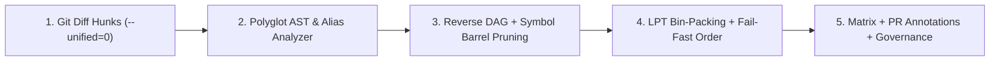

# ⚡ Vortex — AST-Driven Predictive CI, Symbol-Level Barrel Pruner & LPT Test Splitter

[](https://github.com/marketplace/actions/vortex-ast-predictive-ci-test-splitter)
[](https://deno.com)
[](#5-stage-architecture)
[](https://glastor.es)
[](./LICENSE)

**Vortex (`glastor-core/vortex` `v1.1.0`)** is an enterprise-grade **AST-Driven Predictive CI Orchestrator, Symbol-Level Barrel Pruner, Reverse Dependency DAG Analyzer, LPT Dynamic Test Splitter, EWMA Telemetry Learner, and Governance Gatekeeper** for GitHub Actions.

Unlike legacy CI platforms (such as CircleCI or naive `paths:` filters in GitHub Actions) that blindly re-run entire test suites when a single line changes, **Vortex** parses the exact **Git Diff Hunks (`--unified=0`)**, intersects them with **Abstract Syntax Tree (AST) symbol declarations**, prunes unaffected barrel/utility imports at the **individual symbol level**, and packs only the impacted tests into mathematically balanced, **Fail-Fast ordered LPT (`strategy.matrix`) shards** in **`<30ms`**.

---

## ✨ Why Vortex Outperforms Legacy CI Orchestrators

| Capability                             |   Standard GitHub Actions    |           CircleCI            |                       ⚡ **GLASTOR® Vortex (`@v1`)**                       |
| :------------------------------------- | :--------------------------: | :---------------------------: | :------------------------------------------------------------------------: |
| **Impact Detection Granularity**       | File/Folder Globs (`paths:`) |          File Globs           |               **AST Symbol-Level (`git diff` ∩ AST Ranges)**               |
| **Barrel / Shared Utils Pruning**      |    ❌ Runs all importers     |     ❌ Runs all importers     |       ✅ **Symbol-Level Import Pruning (`import { fnB }` vs `fnA`)**       |
| **Comment & Formatting Noise Filter**  |       ❌ Runs full CI        |        ❌ Runs full CI        |              ✅ **Instant `should-run=false` (`0ms` wasted)**              |
| **Monorepo Path Alias Resolution**     |          ❌ Manual           |           ❌ Manual           |         ✅ **Auto-resolves `deno.json` & `tsconfig.json` aliases**         |
| **Dynamic Test Splitting**             |      ❌ Manual matrices      | ⚠️ Paid tier + external agent |        ✅ **Greedy LPT Bin-Packing + Fail-Fast Intra-Shard Order**         |
| **Historical Timing & Flaky Learning** |           ❌ None            |       ⚠️ Paid Insights        |             ✅ **Automatic EWMA Learning (JUnit XML & JSON)**              |
| **PR Governance & DevSecOps Bridge**   |           ❌ None            |            ❌ None            | ✅ **Jira/Linear Ticket Extraction, Blast-Radius Gate & `nemesis` Bridge** |

---

## 🚀 Quick Start (GitHub Actions Marketplace)

```yaml
name: "Predictive CI Pipeline"

on:
  pull_request:
  push:
    branches: [main, master]

permissions:
  contents: read
  pull-requests: write # Optional: enables sticky PR report comments

jobs:
  # 1. Analyze AST Blast Radius, Prune Barrel Imports & Generate LPT Shards in <30ms
  vortex-brain:
    name: "⚡ Vortex AST Impact & Sharding"
    runs-on: ubuntu-latest
    outputs:
      should_run: ${{ steps.vortex.outputs.should-run }}
      matrix: ${{ steps.vortex.outputs.matrix }}
      nemesis_files: ${{ steps.vortex.outputs.nemesis-target-files }}
    steps:
      - name: Checkout Repository (Full History for Diff)
        uses: actions/checkout@v4
        with:
          fetch-depth: 0

      - name: Run Vortex AST Impact Engine
        id: vortex
        uses: glastor-core/vortex@v1
        env:
          GITHUB_TOKEN: ${{ secrets.GITHUB_TOKEN }}
        with:
          shards: "4"
          symbol-pruning: "true"
          max-blast-radius: "85"
          post-pr-comment: "true"
          base-ref: ${{ github.event_name == 'pull_request' && github.event.pull_request.base.sha || 'HEAD~1' }}
          head-ref: "HEAD"

  # 2. Execute Only Impacted Test Suites Across Fail-Fast Ordered Parallel Shards
  surgical-tests:
    name: "🧪 Surgical Shard #${{ matrix.shard_id }}"
    needs: vortex-brain
    if: needs.vortex-brain.outputs.should_run == 'true'
    runs-on: ubuntu-latest
    strategy:
      fail-fast: false
      matrix: ${{ fromJson(needs.vortex-brain.outputs.matrix) }}
    steps:
      - uses: actions/checkout@v4
      - uses: denoland/setup-deno@v2
      - name: Execute Assigned Test Suites
        run: deno test ${{ matrix.test_files }}
```

---

## 🧠 5-Stage Architecture (`v1.1.0`)



1. **Stage 1 — Surgical Diff Hunk Extraction ([diff-parser.ts](file:///c:/Users/ricsg/Desktop/vortex/src/git/diff-parser.ts))**: Extracts exact modified line intervals (`[startLine, endLine]`) and filters out non-functional changes (comments, docstrings, whitespace/indentation).
2. **Stage 2 — Polyglot AST Symbol Fingerprinting & Monorepo Alias Resolution ([analyzer.ts](file:///c:/Users/ricsg/Desktop/vortex/src/ast/analyzer.ts))**: Maps modified line hunks onto AST declarations (`function`, `class`, `const`, `interface`, `type`, `enum`), expands intra-module callers (`expandIntraModuleMutatedSymbols`), and resolves `deno.json` `imports` and `tsconfig.json` `paths` aliases.
3. **Stage 3 — Reverse Dependency DAG & Symbol-Level Barrel Pruning ([dag.ts](file:///c:/Users/ricsg/Desktop/vortex/src/graph/dag.ts))**: Traverses the Reverse DAG via BFS while pruning false-positive barrel/utility edges when a consumer only imports unmutated symbols (`import { fnB } from "./utils.ts"` when only `fnA` changed).
4. **Stage 4 — LPT Bin-Packing, Fail-Fast Intra-Shard Ordering & EWMA Telemetry ([lpt-splitter.ts](file:///c:/Users/ricsg/Desktop/vortex/src/scheduler/lpt-splitter.ts))**: Updates historical test durations and flakiness rates via Exponentially Weighted Moving Average ($\alpha = 0.3$), quarantines unstable tests, balances shards via Greedy LPT, and orders tests inside each shard so direct-impact and fast unit tests fail first.
5. **Stage 5 — FinOps Summary, PR Annotations & DevSecOps Gatekeeper ([finops-reporter.ts](file:///c:/Users/ricsg/Desktop/vortex/src/reporters/finops-reporter.ts), [gatekeeper.ts](file:///c:/Users/ricsg/Desktop/vortex/src/governance/gatekeeper.ts))**: Emits native GitHub workflow annotations (`::notice`, `::warning`, `::error`), sticky PR comments, Jira/Linear ticket keys (`ticket-ids`), `max-blast-radius` enforcement, and `nemesis-target-files` for surgical security auditing with [**`glastor-core/nemesis`**](https://github.com/glastor-core/nemesis).

---

## ⚙️ Inputs Reference (`action.yml` — 22 Inputs)

| Input                  |         Default          | Description                                                                           |
| :--------------------- | :----------------------: | :------------------------------------------------------------------------------------ |
| `config-path`          |      `.vortex.yml`       | Path to optional repository configuration file.                                       |
| `workspace`            |           `.`            | Target repository workspace directory.                                                |
| `base-ref`             |         `HEAD~1`         | Base Git reference or commit SHA to compare against.                                  |
| `head-ref`             |          `HEAD`          | Head Git reference or commit SHA to analyze.                                          |
| `shards`               |           `4`            | Maximum number of parallel shards to generate via LPT Bin-Packing (`1`-`64`).         |
| `test-globs`           |         _(Auto)_         | Comma-separated glob patterns matching test suites.                                   |
| `fail-safe-globs`      |         _(Auto)_         | Comma-separated globs that force full test suite execution when modified.             |
| `symbol-pruning`       |          `true`          | Enable Symbol-Level AST Barrel Pruning (ignore consumers of unmutated symbols).       |
| `telemetry-path`       | `.vortex/telemetry.json` | Path to historical test duration and flakiness telemetry JSON store.                  |
| `update-telemetry`     |           `""`           | Path to a JUnit XML or JSON test report to ingest via EWMA auto-learning.             |
| `ewma-alpha`           |          `0.3`           | EWMA smoothing factor $\alpha$ (`0.05` - `0.95`) for telemetry learning.              |
| `flaky-quarantine`     |          `true`          | Automatically quarantine unstable tests exceeding `flaky-threshold`.                  |
| `flaky-threshold`      |          `0.35`          | Flakiness rate (`0.05` - `1.0`) above which a test is quarantined.                    |
| `ignore-type-only`     |         `false`          | Ignore compile-time `interface` / `type` edits for runtime test execution.            |
| `max-blast-radius`     |          `100`           | Maximum allowed blast-radius score (`0` - `100`) before Gatekeeper flags/fails.       |
| `fail-on-blast-radius` |         `false`          | Exit with code `1` if `blast-radius-score` exceeds `max-blast-radius`.                |
| `ticket-context`       |           `""`           | Optional branch/PR title/commit string to extract Jira/Linear/GitHub issue keys.      |
| `emit-annotations`     |          `true`          | Emit native GitHub Actions workflow annotations (`::notice`, `::warning`, `::error`). |
| `post-pr-comment`      |         `false`          | Post or update an idempotent sticky PR comment when `GITHUB_TOKEN` is set.            |
| `runner-cost-per-min`  |         `0.016`          | Cloud runner cost per minute in USD for FinOps calculations.                          |
| `report-file`          |   `vortex-report.json`   | Output file path for the complete JSON report.                                        |
| `write-summary`        |          `true`          | Append Markdown & Mermaid report to `$GITHUB_STEP_SUMMARY`.                           |

---

## 📤 Outputs Reference (`$GITHUB_OUTPUT` — 15 Outputs)

| Output                 |   Type   | Description                                                                   |
| :--------------------- | :------: | :---------------------------------------------------------------------------- |
| `should-run`           | `string` | `'true'` or `'false'` — whether downstream test jobs should run.              |
| `execution-mode`       | `string` | `'skip'`, `'surgical'`, or `'full-fail-safe'`.                                |
| `affected-tests`       | `string` | Space-separated list of impacted test file paths.                             |
| `affected-count`       | `string` | Number of test suites selected for execution.                                 |
| `skipped-count`        | `string` | Number of unaffected test suites safely skipped.                              |
| `pruned-edges-count`   | `string` | Number of barrel dependency edges eliminated via Symbol-Level Pruning.        |
| `quarantined-tests`    | `string` | Space-separated list of flaky test files isolated in quarantine.              |
| `time-saved-seconds`   | `string` | Estimated wall-clock seconds saved by AST pruning & LPT sharding.             |
| `savings-percent`      | `string` | Percentage of CI execution time saved (`0` - `100`).                          |
| `blast-radius-score`   | `string` | Calculated AST blast-radius severity score (`0` - `100`).                     |
| `blast-radius-passed`  | `string` | `'true'` or `'false'` — whether blast radius is within `max-blast-radius`.    |
| `ticket-ids`           | `string` | Comma-separated Jira, Linear, or GitHub issue keys (e.g., `GLS-402,PROJ-12`). |
| `nemesis-target-files` | `string` | Space-separated list of modified & impacted files for `glastor-core/nemesis`. |
| `matrix`               |  `json`  | Ready-to-use GitHub Actions `strategy.matrix` payload (`{ include: [...] }`). |
| `report-path`          | `string` | Absolute path to the generated `vortex-report.json` artifact.                 |

---

## 🔐 Required Permissions & Zero-Trust AppSec Posture

**Vortex** adheres to the principle of **Least Privilege** (`GITHUB_TOKEN`) and includes built-in CWE/OWASP guards ([`src/security.ts`](./src/security.ts)):

| Permission Scope | Access Level | When Required                                                                                               |
| :--------------- | :----------: | :---------------------------------------------------------------------------------------------------------- |
| `contents`       |    `read`    | **Always Required** — allows `actions/checkout@v4` to read repository history and AST files.                |
| `pull-requests`  |   `write`    | **Optional** — only required when `post-pr-comment: 'true'` is enabled to publish/update sticky PR reports. |

### Built-in CWE Security Hardening

- **Zero External Dependencies:** 100% native Deno 2 standard runtime (`node:util`, `node:fs`, `node:path`) — immune to third-party npm/JSR supply-chain attacks.
- **CWE-88 (Git Argument Injection):** Strictly validates `base-ref` and `head-ref` against leading `-` flags and injects `--` path delimiters.
- **CWE-22 (Path Traversal Containment):** Enforces lexical workspace containment on `report-file`, `telemetry-path`, `update-telemetry`, and diff file paths.
- **CWE-78 / CWE-93 (Workflow Command & Output Injection):** Escapes `%`, `\r`, `\n`, `:`, and `,` across all `::notice`/`::warning`/`::error` annotations and `$GITHUB_OUTPUT` values, and rejects shell metacharacters in test paths.
- **CWE-918 (SSRF & DoS Prevention):** Validates `https://` transport on `GITHUB_API_URL` and enforces a strict `5000ms` `AbortSignal.timeout`.

---

## 💻 Local CLI Usage

```bash
# Run full AST impact analysis on current repository
deno task start

# Preview with custom shard count, ticket context, and blast-radius gate
deno task start --base-ref HEAD~1 --shards 4 --max-blast-radius 85 --ticket-context "feat/GLS-402"

# Format, lint, type-check, and execute the full 13-test suite
deno fmt --check
deno lint
deno task check
deno task test
```

---

## 🏢 Ecosystem & Corporate Governance

Engineered and maintained by **GLASTOR® Core** (`@glastor-dev`):

- **Official Website:** [https://glastor.es](https://glastor.es)
- **Enterprise Contact:** [ventas@glastor.es](mailto:ventas@glastor.es)
- **Companion DevSecOps Auditor:** Combine **Vortex** (CI Speed & AST Intelligence) with [**`glastor-core/nemesis`**](https://github.com/glastor-core/nemesis) (SAST, SCA, Secrets & CycloneDX SBOM) for a complete Zero-Trust CI/CD pipeline.
