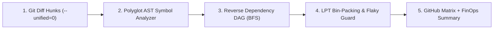

# ⚡ Vortex — AST-Driven Predictive CI, Blast-Radius DAG & LPT Test Splitter

[](https://github.com/marketplace/actions/vortex-ast-predictive-ci-test-splitter)
[](https://deno.com)
[](#5-stage-architecture)
[](https://glastor.es)
[](./LICENSE)

**Vortex (`glastor-core/vortex`)** is a next-generation **AST-Driven Predictive CI Orchestrator, Reverse Dependency DAG Analyzer, LPT Dynamic Test Splitter, and FinOps Telemetry Engine** for GitHub Actions.

Unlike traditional CI platforms (such as CircleCI or naive `paths:` filters in GitHub Actions) that blindly re-run entire test suites when a single line changes, **Vortex** parses the exact **Git Diff Hunks (`--unified=0`)**, intersects them with **Abstract Syntax Tree (AST) symbol declarations**, computes transitive reachability across the **Reverse Dependency DAG**, and packs only the impacted tests into mathematically balanced **LPT (`strategy.matrix`) shards** in **`<30ms`**.

---

## ✨ Why Vortex Outperforms Legacy CI Orchestrators

| Capability                             |   Standard GitHub Actions    |           CircleCI            |                  ⚡ **GLASTOR® Vortex (`@v1`)**                   |
| :------------------------------------- | :--------------------------: | :---------------------------: | :---------------------------------------------------------------: |
| **Impact Detection Granularity**       | File/Folder Globs (`paths:`) |          File Globs           |          **AST Symbol-Level (`git diff` ∩ AST Ranges)**           |
| **Comment & Formatting Noise Filter**  |       ❌ Runs full CI        |        ❌ Runs full CI        |         ✅ **Instant `should-run=false` (`0ms` wasted)**          |
| **Transitive Call-Graph / Import DAG** |           ❌ None            |       ❌ Manual config        |      ✅ **Automatic Reverse Dependency BFS (`impactChain`)**      |
| **Dynamic Test Splitting**             |      ❌ Manual matrices      | ⚠️ Paid tier + external agent |    ✅ **Built-in Greedy LPT Bin-Packing (`strategy.matrix`)**     |
| **Flaky Test Quarantine**              |      ❌ Fails pipeline       |       ⚠️ Paid Insights        |       ✅ **Automatic Flaky Isolation (`flaky-threshold`)**        |
| **FinOps & Green-CI PR Telemetry**     |           ❌ None            |     ❌ External dashboard     | ✅ **Native Mermaid Graph + USD & $\text{CO}_2\text{e}$ Savings** |
| **Supply-Chain Footprint**             |            Varies            |         External SaaS         |      ✅ **Zero External Dependencies (100% Native Deno 2)**       |

---

## 🚀 Quick Start (GitHub Actions Marketplace)

Add **Vortex** as the initial brain job in `.github/workflows/ci.yml`:

```yaml
name: "Predictive CI Pipeline"

on:
  pull_request:
  push:
    branches: [main, master]

permissions:
  contents: read

jobs:
  # 1. Analyze AST Blast Radius & Generate LPT Balanced Shards in <30ms
  vortex-brain:
    name: "⚡ Vortex AST Impact & Sharding"
    runs-on: ubuntu-latest
    outputs:
      should_run: ${{ steps.vortex.outputs.should-run }}
      matrix: ${{ steps.vortex.outputs.matrix }}
      affected_tests: ${{ steps.vortex.outputs.affected-tests }}
    steps:
      - name: Checkout Repository (Full History for Diff)
        uses: actions/checkout@v4
        with:
          fetch-depth: 0

      - name: Run Vortex AST Impact Engine
        id: vortex
        uses: glastor-core/vortex@v1
        with:
          shards: "4"
          base-ref: ${{ github.event_name == 'pull_request' && github.event.pull_request.base.sha || 'HEAD~1' }}
          head-ref: "HEAD"

  # 2. Execute Only Impacted Test Suites Across Balanced Parallel Shards
  surgical-tests:
    name: "🧪 Surgical Shard #${{ matrix.shard_id }}"
    needs: vortex-brain
    if: needs.vortex-brain.outputs.should_run == 'true'
    runs-on: ubuntu-latest
    strategy:
      fail-fast: false
      matrix: ${{ fromJson(needs.vortex-brain.outputs.matrix) }}
    steps:
      - uses: actions/checkout@v4
      - uses: denoland/setup-deno@v2
      - name: Execute Assigned Test Suites
        run: deno test ${{ matrix.test_files }}
```

---

## 🧠 5-Stage Architecture



1. **Stage 1 — Surgical Diff Hunk Extraction (`src/git/diff-parser.ts`)**: Extracts exact modified line intervals (`[startLine, endLine]`) and filters out non-functional changes (comments, docstrings, whitespace/indentation).
2. **Stage 2 — Polyglot AST Symbol Fingerprinting (`src/ast/analyzer.ts`)**: Maps modified line hunks onto AST declarations (`function`, `class`, `const`, `interface`, `type`, `enum`) and resolves relative & module imports across TypeScript, JavaScript, Deno, Python, Rust, and Go.
3. **Stage 3 — Reverse Dependency DAG & Fail-Safe Guard (`src/graph/dag.ts`)**: Builds the inverted dependency graph in memory and runs Breadth-First Search (BFS) from mutated symbols to locate every directly or transitively affected test file—or escalates to `full-fail-safe` mode if critical files (`deno.json`, `package.json`, `.github/workflows/**`) changed.
4. **Stage 4 — LPT Mathematical Bin-Packing & Flaky Quarantine (`src/scheduler/lpt-splitter.ts`)**: Isolates flaky tests exceeding `flaky-threshold` and distributes the remaining affected tests across $K$ parallel shards using the **Greedy Longest Processing Time (LPT)** algorithm to minimize makespan ($C_{\max}$).
5. **Stage 5 — FinOps, Green-CI & Mermaid Step Summary (`src/reporters/finops-reporter.ts`)**: Emits `$GITHUB_OUTPUT` variables, `vortex-report.json`, and a rich `$GITHUB_STEP_SUMMARY` featuring a Mermaid Blast-Radius diagram, mutated AST symbol table, USD runner savings, and $\text{CO}_2\text{e}$ reduction.

---

## ⚙️ Inputs Reference (`action.yml`)

| Input                 |         Default          | Description                                                                   |
| :-------------------- | :----------------------: | :---------------------------------------------------------------------------- |
| `config-path`         |      `.vortex.yml`       | Path to optional repository configuration file.                               |
| `workspace`           |           `.`            | Target repository workspace directory.                                        |
| `base-ref`            |         `HEAD~1`         | Base Git reference or commit SHA to compare against.                          |
| `head-ref`            |          `HEAD`          | Head Git reference or commit SHA to analyze.                                  |
| `shards`              |           `4`            | Maximum number of parallel shards to generate via LPT Bin-Packing (`1`-`64`). |
| `test-globs`          |         _(Auto)_         | Comma-separated glob patterns matching test suites (`**/*.test.ts`, etc.).    |
| `fail-safe-globs`     |         _(Auto)_         | Comma-separated globs that force full test suite execution when modified.     |
| `telemetry-path`      | `.vortex/telemetry.json` | Path to historical test duration and flakiness telemetry JSON store.          |
| `flaky-quarantine`    |          `true`          | Automatically quarantine unstable tests exceeding `flaky-threshold`.          |
| `flaky-threshold`     |          `0.35`          | Flakiness rate (`0.05` - `1.0`) above which a test is quarantined.            |
| `ignore-type-only`    |         `false`          | Ignore compile-time `interface` / `type` edits for runtime test execution.    |
| `runner-cost-per-min` |         `0.016`          | Cloud runner cost per minute in USD for FinOps calculations.                  |
| `report-file`         |   `vortex-report.json`   | Output file path for the complete JSON report.                                |
| `write-summary`       |          `true`          | Append Markdown & Mermaid report to `$GITHUB_STEP_SUMMARY`.                   |

---

## 📤 Outputs Reference (`$GITHUB_OUTPUT`)

| Output               |   Type   | Description                                                                   |
| :------------------- | :------: | :---------------------------------------------------------------------------- |
| `should-run`         | `string` | `'true'` or `'false'` — whether downstream test jobs should run.              |
| `execution-mode`     | `string` | `'skip'`, `'surgical'`, or `'full-fail-safe'`.                                |
| `affected-tests`     | `string` | Space-separated list of impacted test file paths.                             |
| `affected-count`     | `string` | Number of test suites selected for execution.                                 |
| `skipped-count`      | `string` | Number of unaffected test suites safely skipped.                              |
| `quarantined-tests`  | `string` | Space-separated list of flaky test files isolated in quarantine.              |
| `time-saved-seconds` | `string` | Estimated wall-clock seconds saved by AST pruning & LPT sharding.             |
| `savings-percent`    | `string` | Percentage of CI execution time saved (`0` - `100`).                          |
| `blast-radius-score` | `string` | Calculated AST blast-radius severity score (`0` - `100`).                     |
| `matrix`             |  `json`  | Ready-to-use GitHub Actions `strategy.matrix` payload (`{ include: [...] }`). |
| `report-path`        | `string` | Absolute path to the generated `vortex-report.json` artifact.                 |

---

## 💻 Local CLI Usage

```bash
# Run full AST impact analysis on current repository
deno task start

# Preview with custom shard count and base ref
deno task start --base-ref HEAD~1 --shards 4 --ignore-type-only

# Run formatter, linter, strict type checker, and test suite
deno fmt --check
deno lint
deno task check
deno task test
```

---

## 🏢 Ecosystem & Corporate Governance

Engineered and maintained by **GLASTOR® Core** (`@glastor-dev`):

- **Official Website:** [https://glastor.es](https://glastor.es)
- **Enterprise Contact:** [ventas@glastor.es](mailto:ventas@glastor.es)
- **Companion DevSecOps Auditor:** Combine **Vortex** (CI Speed & AST Intelligence) with [**`glastor-core/nemesis`**](https://github.com/glastor-core/nemesis) (SAST, SCA, Secrets & CycloneDX SBOM) for a complete Zero-Trust CI/CD pipeline.
